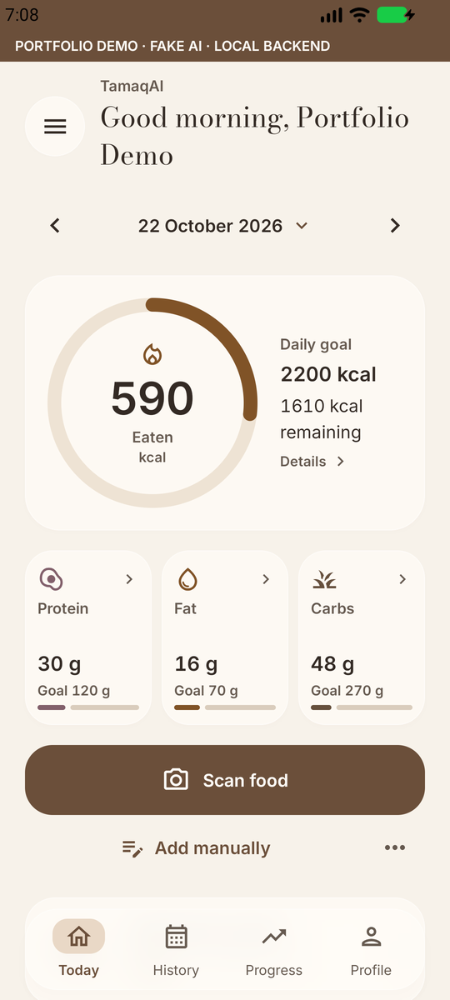
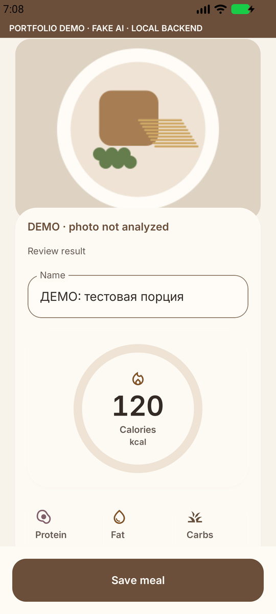
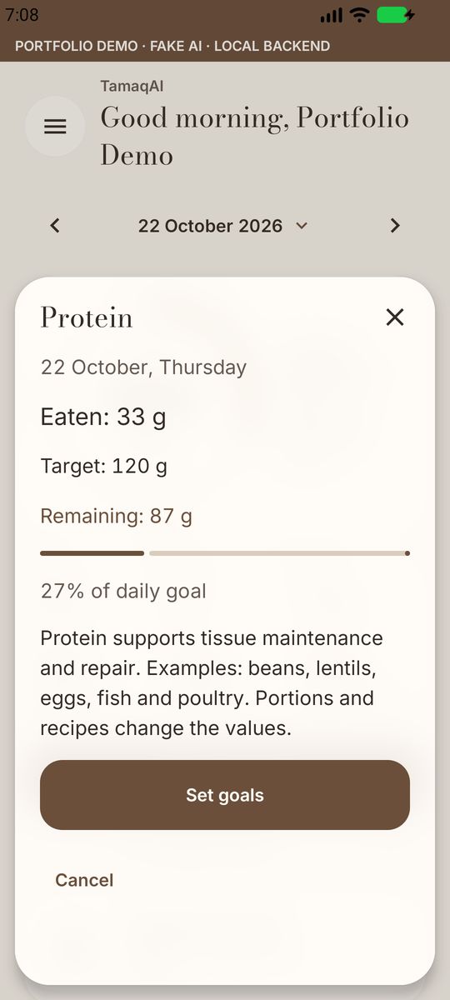
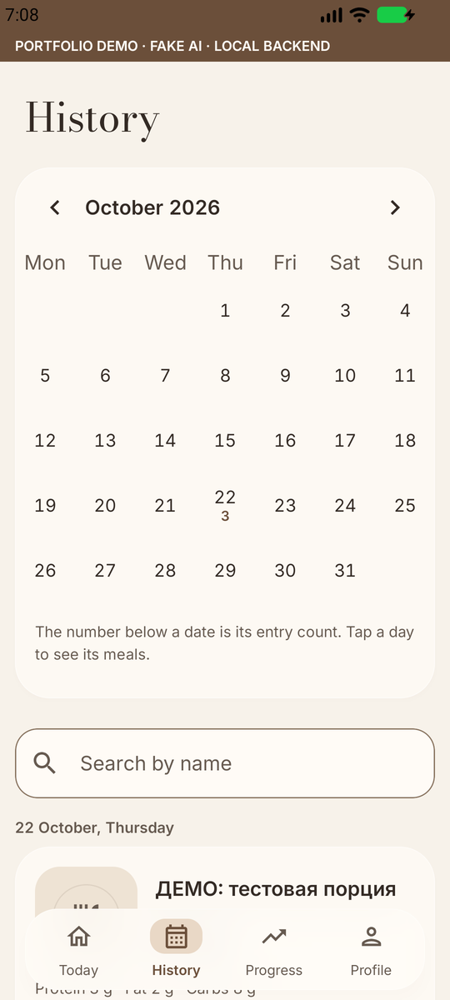
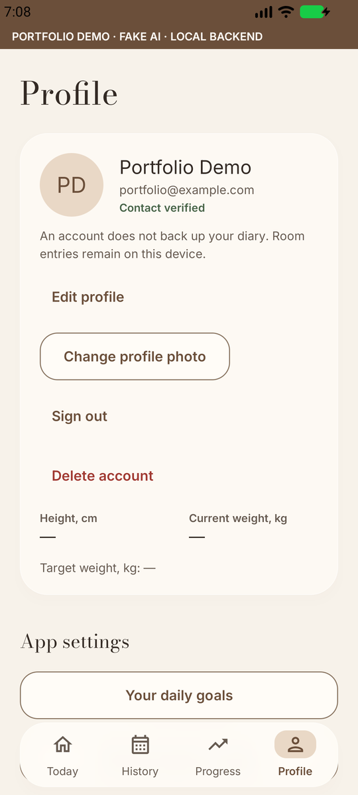
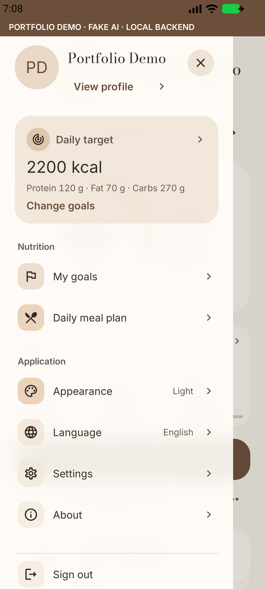
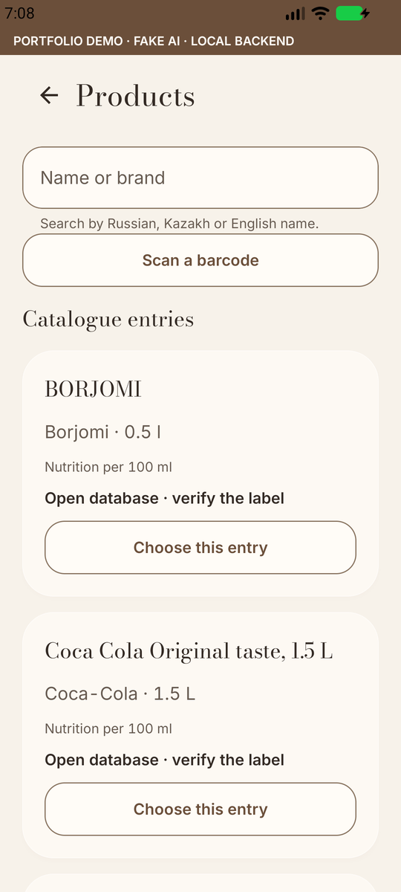
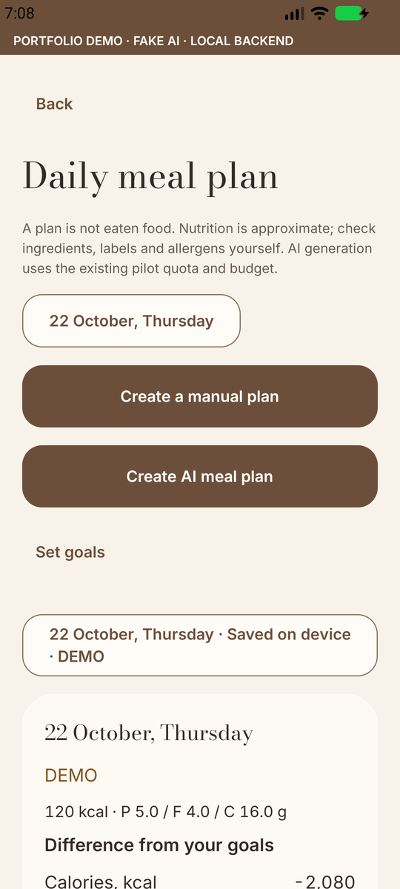
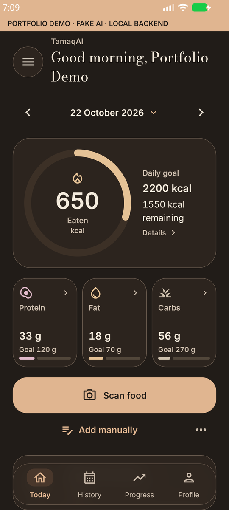
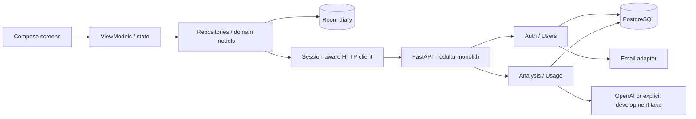

# TamaqAI · Android portfolio

**An Android food diary with a reviewable photo-to-meal workflow.**

TamaqAI reduces manual meal entry: take a photo, review proposed ingredients and quantities, adjust what you ate, then confirm. Confirmed meals feed daily calorie and macronutrient totals. Photo analysis is an estimate: the model can misidentify recipes, ingredients and mass. It is not a measured calorie count or medical assessment.

[79-second video — no installation required](https://github.com/kairagz27/TamaqAI-Portfolio/releases) · [Architecture](docs/ARCHITECTURE.md) · [Verification](docs/PUBLICATION_VERIFICATION.md) · [Русский](README.ru.md)

This portfolio edition starts from a prepared project snapshot, source commit `4d1473f8a34e230f0b0203d5f036bdb955eed603`. It has a new Git history; earlier development commits have not been recreated. [Authorship](AUTHORS.md) · [Export provenance](docs/export/README.md).

## Try the workflow

**Video:** the release attachments contain a recording of the running app, viewable or downloadable without installing Android. The repository is currently **private** and the first release is a **draft**: preview access requires the owner's GitHub permissions. Public access is pending a separate visibility decision.

**Before downloading the demo APK:** it requires Docker services on your computer at **`http://127.0.0.1:8100`** and an authorized device/emulator with **`adb reverse tcp:8100 tcp:8100`**. The APK is **not standalone** and has no hosted backend. Run the [local setup](docs/DEVELOPMENT.md) first.

[Demo APK and video — private draft attachments](https://github.com/kairagz27/TamaqAI-Portfolio/releases) · [Complete demo instructions](docs/DEMO.md)

The separate `com.tamaqai.demo` application displays **FAKE AI · LOCAL BACKEND**. Its deterministic provider demonstrates review, portions and persistence, not recognition quality. A standalone demonstration is a possible future improvement; it is not included in this release.

## The application

<table>
<tr><td><br/>Today</td><td><br/>Review ingredients</td><td><br/>Nutrients</td></tr>
<tr><td><br/>History</td><td><br/>Profile</td><td><br/>Navigation</td></tr>
<tr><td><br/>Catalogue</td><td><br/>Meal plan</td><td><br/>Dark theme</td></tr>
</table>

Actual application captures use synthetic fixtures and an explicitly labelled fake provider. [Capture conditions](docs/DEMO.md).

## Implemented capabilities

- Photo drafts, asynchronous analysis, editable components and eaten fractions. Local edits recalculate from baseline values without another AI call.
- Confirmation before totals; Room diary, history, goals and settings survive process restarts. Unknown nutrition marks totals incomplete.
- Registration, verification/recovery, rotating refresh sessions and coordinated Android refresh. Explicit guest linking requires proof of both sessions.
- Owner-scoped data. Registration does not mint an AI budget or bypass pilot invitations. An account is **not a cloud backup of the Room diary**.
- PostgreSQL-backed idempotency, results, quotas, reservations and usage. Repeated analysis keys can reuse results.
- Barcode lookup, cached catalogue use and nutrition snapshots in confirmed entries. Product updates do not rewrite old meals.
- RU/KK/EN, warm light/dark glass surfaces, local fonts, questionnaire, goals and editable meal plans.

The Kazakhstan starter catalogue distributes **39 attributed Open Food Facts products**. Community country tags do not prove nationwide availability or label accuracy. Manufacturer/menu datasets with unconfirmed redistribution terms are withheld; no complete verified Coffee Boom dataset is distributed. [Sources](docs/DATA_SOURCES.md).

## Architecture



Pragmatic layers with MVVM-style state, not strict Clean Architecture: some screens coordinate repositories directly. Local diary and cached-product scenarios work offline; authentication and new AI analyses need a backend.

| Technology | Role and reason |
|---|---|
| Kotlin / Compose / Material 3 | Native UI and shared state/theme |
| Coroutines / Flow | Asynchronous state and cancellation |
| Room | Local transactions and explicit migrations |
| CameraX / ZXing | Camera lifecycle and barcode decoding |
| FastAPI / Pydantic | Typed HTTP boundary and validation |
| PostgreSQL / Psycopg | Durable auth, usage and budget transactions |
| Docker Compose / Mailpit | Isolated services and local test email |
| GitHub Actions | Checks without production secrets or paid AI |

## Run the safe demo

Requires Docker Compose, Python 3.12+, JDK 21, Android SDK 36 and an emulator. From the repository root:

```sh
python backend/scripts/portfolio_demo.py init
docker compose -f compose.demo.yaml up --build -d --wait
python backend/scripts/portfolio_demo.py smoke
python backend/scripts/portfolio_demo.py catalog
adb reverse tcp:8100 tcp:8100
./gradlew assembleDemo
adb install -r app/build/outputs/apk/demo/app-demo.apk
```

Windows: use `py -3.12` if needed and `./gradlew.bat`. Generated `.demo/` files are ignored. Open `.demo/user.json` privately for the synthetic login. Mailpit: `http://127.0.0.1:8125`; health: `http://127.0.0.1:8100/health`.

The separate `com.tamaqai.demo` package shows a persistent **FAKE AI · LOCAL BACKEND** banner. Its loopback URL needs local services and adb reverse; the APK alone is not a hosted demo. Compose forces fake AI and an empty OpenAI key. Backend/SMTP have no external network route. Pilot configuration, volumes and ledger are not used. Production rejects fake mode. [Instructions](docs/DEVELOPMENT.md).

## Checks

```sh
python -m pip install -r backend/requirements.lock.txt -r tools/requirements-docs.txt
python backend/scripts/portfolio_demo.py test
python tools/test_warm_glass_tools.py
python tools/test_publication_history.py
python tools/test_record_portfolio_demo.py
python tools/check_readme.py
./gradlew assembleDebug assembleRelease assembleDemo testDebugUnitTest lintDebug lintRelease lintDemo -PtamaqEnvironment=usb -PtamaqReleaseBackendUrl=https://pilot.example.com
```

The HTTPS value is a build-validation placeholder, not a deployed service. [Actual dated results](docs/PUBLICATION_VERIFICATION.md). No coverage percentage or frame-rate guarantee is claimed.

## Status

Active development. Hosting, external email, backup/restore and broader device profiling require separate verification. Mailpit proves local delivery only. Emulator checks do not establish Xiaomi 15 smoothness.

One additional full emulator capture hit a Compose/Espresso idle timeout before activity teardown; a focused five-cycle navigation probe passed. This intermittent capture failure is recorded in the verification report and remains under investigation, rather than being counted as a passing run.

This export contains only an explicit reviewed file list, not the private development repository or its old Git objects. Unconfirmed reference artwork and manufacturer/menu datasets are excluded. The original development repository remains private and unchanged. See the [export audit](docs/export/README.md) and [roadmap](docs/ROADMAP.md).

## Repository

- `app/`: Compose, Room schemas, JVM/device tests.
- `backend/`: FastAPI modules, migrations, locked dependencies and tests.
- `backend/catalog_seed/`: separately licensed data.
- `compose.demo.yaml`, `deploy/`: demo and deployment examples.
- `tools/`, `docs/`: [engineering documentation](docs/README.md), audits and dated evidence.

Original code is [MIT licensed](LICENSE); fonts, dependencies and data have [separate terms](THIRD_PARTY_NOTICES.md). [Contributing](CONTRIBUTING.md) · [Security](SECURITY.md).
