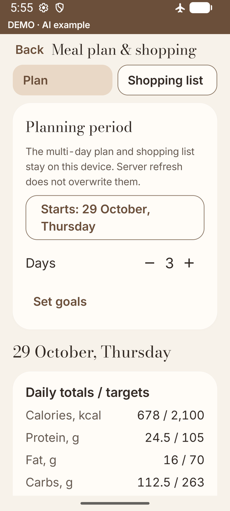
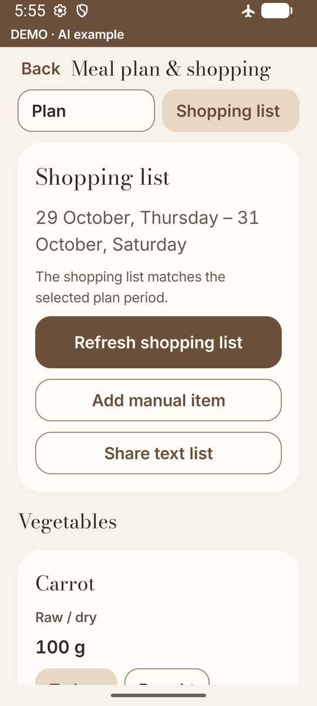
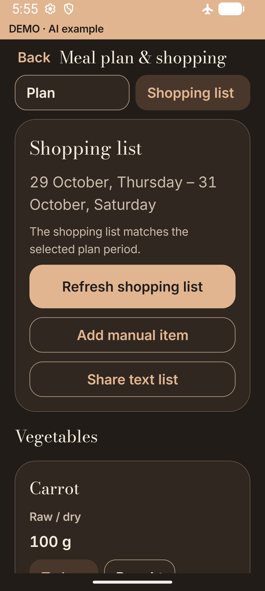
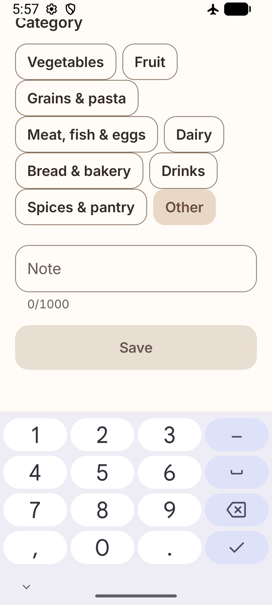
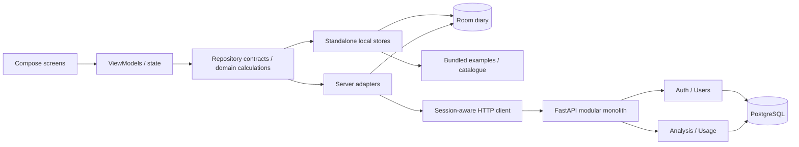

# TamaqAI · Android portfolio

**A native food diary with multi-day meal plans and a portion-aware shopping list.**

TamaqAI turns a proposed photo result into an editable record. Component quantities and the amount actually eaten are separate controls; confirmed meals feed calorie and macronutrient totals. Photo estimates can be wrong about ingredients and mass, so review remains part of the workflow.

Plan up to a week, scale recipes and refresh a categorized shopping list without
AI calls. Planning stays local; food enters the diary only when you explicitly
confirm what was eaten. The current source/build version is **1.5.0**; it is not
a newly published APK release.

[Server demo video — watch without installing Android](https://github.com/kairagz27/TamaqAI-Portfolio/releases/download/v1.3.1-portfolio.1/tamaqai-demo-fake-ai.mp4) · [Architecture](docs/ARCHITECTURE.md) · [Русский](README.ru.md)

## The application

<table>
<tr><td><br/>Today</td><td><br/>Review ingredients</td><td><br/>Nutrients</td></tr>
<tr><td><br/>History</td><td><br/>Profile</td><td><br/>Navigation</td></tr>
<tr><td><br/>Catalogue</td><td><br/>Meal plan · 1.5.0</td><td><br/>Dark theme</td></tr>
</table>

Actual standalone demo and isolated QA on a 360 dp emulator, using synthetic local
data and the licensed CC0 sample. The plan is updated to 1.5.0.
[Earlier capture conditions](docs/screenshots/standalone/README.md) and
[current planning captures](docs/screenshots/meal-planning/README.md).

## Meal plans → shopping list

<table>
<tr><td><br/>Calculated purchases</td><td><br/>Warm dark theme</td><td><br/>360 dp · 130% text · keyboard</td></tr>
</table>

Actual isolated 1.5.0 QA captures with synthetic records, not mockups.
[All locales, themes and capture conditions](docs/screenshots/meal-planning/README.md).

Choose **1–7 days, default 3**; add recipes to breakfast, lunch, dinner or snacks,
change servings, replace dishes or copy a day. Daily calories and macros are
compared with that date's goals. Six original, translated demo recipes provide
an offline starting point; their nutrition is illustrative, not measured.

The shopping list scales ingredients, combines compatible quantities and groups
them by category. Each product shows which dishes need it. Keep notes and manual
items, mark products bought or already at home, then use Android's text share
menu. A changed plan requests refresh; a larger already-marked quantity requests
review. Refresh preserves your notes, manual items and marks.

Raw and cooked products remain separate. Grams, millilitres and pieces require
explicit conversion facts before being combined. Unknown amounts and nutrition
are shown as incomplete, never as false zeros. Explicit actual-eaten confirmation
is idempotent; planning itself does not create diary records. Room **5 → 6** is an
additive migration, and cached server plans import only by explicit action without
overwriting local changes. [Behavior, limits and verification](docs/MEAL_PLANS_SHOPPING.md)
· [Original recipe data and MIT terms](docs/licenses/demo-recipes.md).

## Two ways to try it

### Standalone Android demo

`standaloneDemo` is a separate package, **`com.tamaqai.standalone`**, with the real Compose screens, calculations and Room persistence. It needs **no backend, Docker, registration, internet or adb reverse**. A first-run welcome identifies the local demo; a persistent **DEMO · AI EXAMPLE** label distinguishes prepared results.

Try the included salad example, edit components and eaten fractions, confirm, then inspect history and totals after a restart. Manual entries, the bundled catalogue, local profile/goals, multi-day planning and shopping lists work on the device. An arbitrary photograph is **not** silently given the prepared answer. The local profile is not a server account or a cloud backup.

**The earlier `v1.4.0-standalone.1` remains a draft release.** It does not contain
the new 1.5.0 planning update. Draft assets are not public downloads; no new release
is published for this task. The previously published release below remains the
server demo. [Releases](https://github.com/kairagz27/TamaqAI-Portfolio/releases)
· [Standalone guide and historical verification](docs/STANDALONE_DEMO.md).

Build locally with JDK 21 and Android SDK 36; no service configuration is needed:

```sh
./gradlew assembleStandaloneDemo
```

APK: `app/build/outputs/apk/standaloneDemo/app-standaloneDemo.apk`. Windows uses `./gradlew.bat`. Build tools are required by the developer, not by someone using the installed APK.

### Technical server demo · existing public release

**Before downloading this APK:** it uses **FAKE AI**, requires Docker services on your computer at **`http://127.0.0.1:8100`** and **`adb reverse tcp:8100 tcp:8100`** for an authorized device/emulator. This **`com.tamaqai.demo` APK is not standalone** and has no hosted backend.

[Download server-demo APK](https://github.com/kairagz27/TamaqAI-Portfolio/releases/download/v1.3.1-portfolio.1/tamaqai-portfolio-demo-debug.apk) · [Existing v1.3.1-portfolio.1 release, video and checksums](https://github.com/kairagz27/TamaqAI-Portfolio/releases/tag/v1.3.1-portfolio.1) · [Local setup](docs/DEVELOPMENT.md)

This path demonstrates FastAPI/PostgreSQL, local Mailpit and the deterministic server provider. Its existing tag and release assets are preserved. Mailpit verifies local test delivery only. [Server-demo walkthrough](docs/DEMO.md).

## What the code demonstrates

- Editable meal drafts, component mass and eaten fractions recalculated from baseline values; confirmation before daily totals. Unknown nutrition marks totals incomplete instead of contributing a false zero.
- Room diary/history, goals, weight tracking, editable plans and catalogue snapshots. Updating catalogue data does not rewrite confirmed meals.
- Offline multi-day recipe planning and computed shopping lists with nullable nutrition, preparation-aware aggregation, durable user marks and explicit diary confirmation.
- RU/KK/EN, warm light/dark glass surfaces and bundled licensed fonts.
- Separate local/server repository implementations selected at the composition root. The standalone manifest removes `INTERNET`; it does not simulate login.
- In server builds: registration/recovery, rotating refresh sessions, explicit guest linking, owner checks, idempotency, quotas, reservations and usage ledger. Registration does not create an AI budget or bypass pilot invitations.

The starter catalogue includes **39 attributed Open Food Facts products**. Source country tags do not prove nationwide availability or label accuracy. Unlicensed manufacturer/menu datasets are withheld. [Data sources](docs/DATA_SOURCES.md).

## Architecture



Pragmatic MVVM-style layers: some screens still coordinate repositories directly.
Planning uses a ViewModel/StateFlow, a repository contract, pure shopping-list
calculation and transactional owner-scoped Room documents. Standalone composition
creates local stores instead of the network/session client. The backend keeps
auth, users, analysis and usage in one deployable application. Account/profile
synchronization is **not cloud synchronization of the Room diary, local plans or
shopping lists**.

| Technology | Role |
|---|---|
| Kotlin / Compose / Material 3 | Native UI, state and shared design system |
| Coroutines / Flow | Asynchronous state and cancellation |
| Room | Local transactions and explicit migrations |
| CameraX / ZXing | Camera lifecycle and local barcode decoding |
| FastAPI / Pydantic | Typed server boundary |
| PostgreSQL / Psycopg | Durable accounts, sessions and budget transactions |
| Docker Compose / Mailpit | Isolated technical demo and local email receiver |
| GitHub Actions | Builds and checks without production secrets or paid AI |

## Development and checks

```sh
python -m pip install -r backend/requirements.lock.txt -r tools/requirements-docs.txt
python tools/test_standalone_tools.py
python tools/check_standalone.py
./gradlew assembleStandaloneDemo testStandaloneDemoUnitTest lintStandaloneDemo -PtamaqStandaloneTest=true
./gradlew connectedStandaloneDemoAndroidTest -PtamaqStandaloneTest=true -Pandroid.testInstrumentationRunnerArguments.class=com.tamaqai.data.StandaloneDemoPersistenceTest

# Isolated multi-day planning, shopping and migration checks.
./gradlew assemblePlanningQa testPlanningQaUnitTest lintPlanningQa -PtamaqPlanningTest=true
./gradlew connectedPlanningQaAndroidTest -PtamaqPlanningTest=true -Pandroid.testInstrumentationRunnerArguments.class=com.tamaqai.data.MealPlanningPersistenceTest,com.tamaqai.ui.PlanningViewModelRecoveryTest,com.tamaqai.ui.MealPlanningUiTest
```

Checks for the existing configurations remain separate:

```sh
python backend/scripts/portfolio_demo.py test
python tools/test_warm_glass_tools.py
python tools/test_publication_history.py
python tools/test_record_portfolio_demo.py
python tools/check_readme.py
./gradlew assembleDebug assembleRelease assembleDemo testDebugUnitTest lintDebug lintRelease lintDemo -PtamaqEnvironment=usb -PtamaqReleaseBackendUrl=https://pilot.example.com
```

The HTTPS value is a build-validation placeholder, not a deployed service. Commands
are instructions, not claims that every check passed. See [1.5.0 planning checks](docs/MEAL_PLANS_SHOPPING.md),
the dated [standalone results](docs/STANDALONE_DEMO.md), [earlier verification](docs/PUBLICATION_VERIFICATION.md)
and [CI runs](https://github.com/kairagz27/TamaqAI-Portfolio/actions/workflows/verify.yml).

Known intermittent Espresso/Compose idle and Activity teardown failures remain documented; a passing focused run does not establish their cause is fixed. Production hosting, real email, backup/restore and broader physical-device checks require separate work. This portfolio does not claim production readiness, recognition accuracy, coverage percentages or a frame-rate guarantee.

## Repository and provenance

- `app/`: Compose, local/server adapters, Room schemas, JVM/device tests.
- `backend/`: FastAPI modules, migrations, locked dependencies and tests.
- `backend/catalog_seed/`: separately licensed source data.
- `compose.demo.yaml`, `deploy/`: technical demo and deployment examples.
- `tools/`, `docs/`: checks and [engineering documentation](docs/README.md).

The public project begins with prepared source snapshot `4d1473f8a34e230f0b0203d5f036bdb955eed603`; earlier development commits were not recreated. The original development repository stays private. [Authorship](AUTHORS.md) · [Export audit](docs/export/README.md).

Original code is [MIT licensed](LICENSE). Fonts, libraries, CC0 example photography and ODbL/DbCL catalogue data retain [separate terms](THIRD_PARTY_NOTICES.md). [Contributing](CONTRIBUTING.md) · [Security](SECURITY.md).
