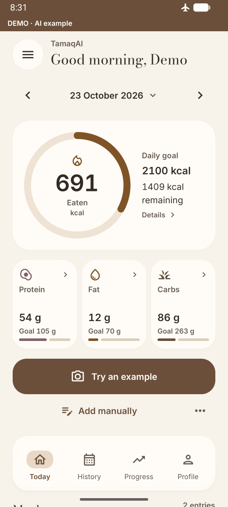
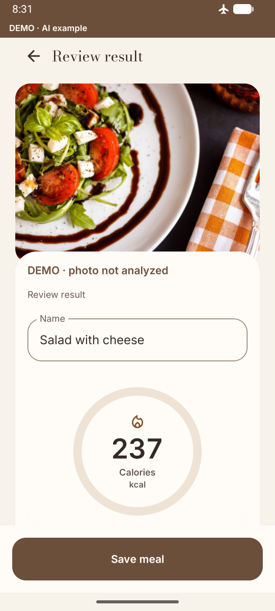
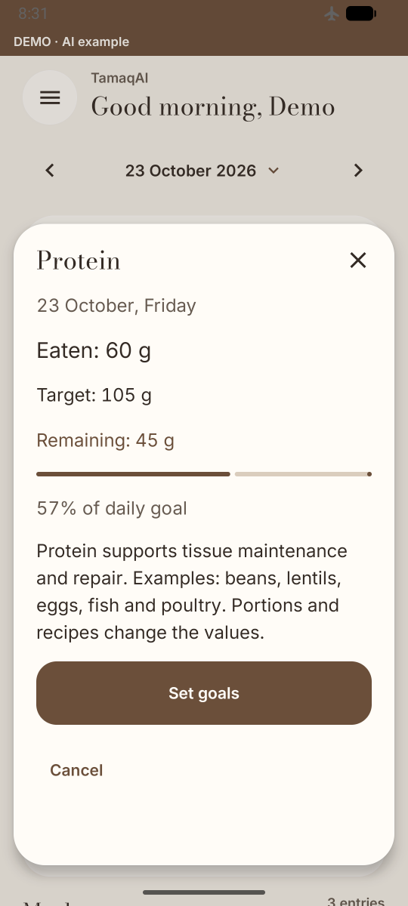
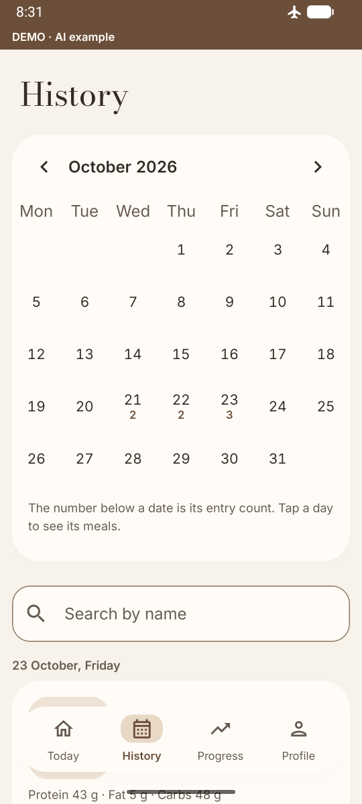
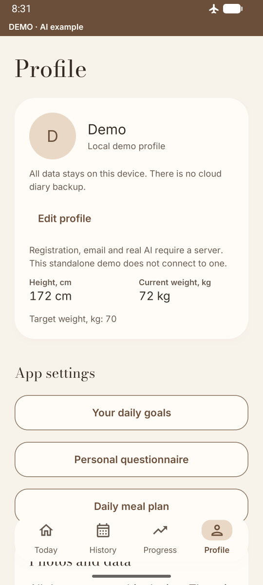
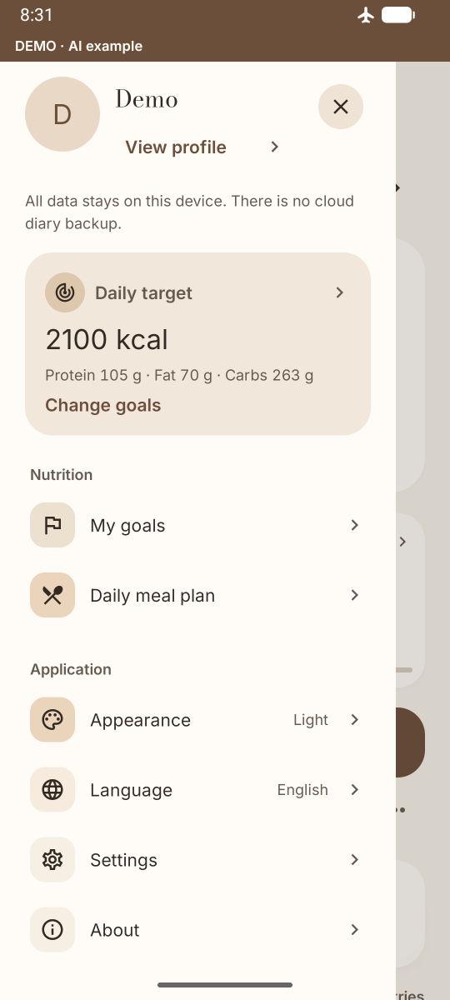
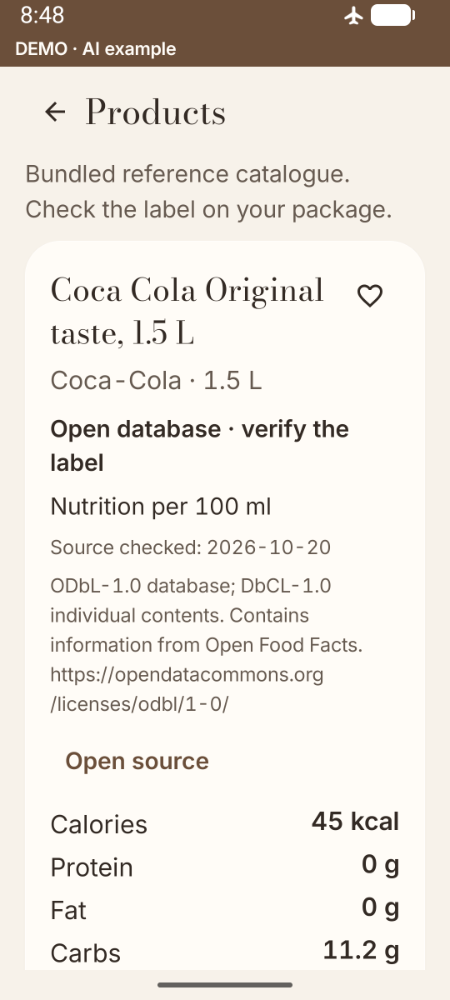
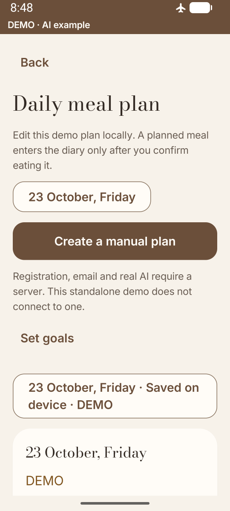
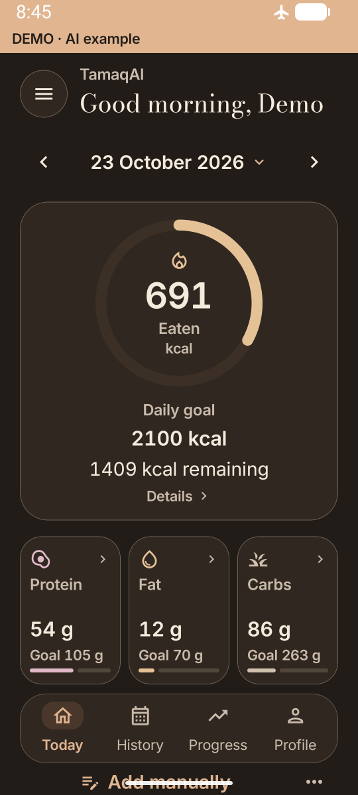

# TamaqAI · Android-портфолио

**Дневник питания: проверить состав, изменить порцию, подтвердить приём пищи и увидеть дневные итоги.**

TamaqAI сокращает ручной ввод: фотография → оценка состава → правки компонентов и съеденной доли → подтверждение. Масса компонента и фактически съеденная часть — разные параметры. Модель может ошибаться в рецепте и массе, поэтому результат нужно проверить; это оценка, а не измерение калорий.

[Видео серверного демо — без установки Android](https://github.com/kairagz27/TamaqAI-Portfolio/releases/download/v1.3.1-portfolio.1/tamaqai-demo-fake-ai.mp4) · [Архитектура](docs/ARCHITECTURE.md) · [English](README.md)

## Приложение

<table>
<tr><td><br/>Сегодня</td><td><br/>Проверка состава</td><td><br/>Нутриенты</td></tr>
<tr><td><br/>История</td><td><br/>Профиль</td><td><br/>Навигация</td></tr>
<tr><td><br/>Каталог</td><td><br/>План питания</td><td><br/>Тёмная тема</td></tr>
</table>

Реальные экраны **автономного демо**, эмулятор 360 dp, синтетические локальные данные и лицензированный пример CC0. Каталог, план и тёмная тема сняты со шрифтом 130%. [Условия съёмки](docs/screenshots/standalone/README.md).

## Два способа попробовать

### Автономное Android-демо

`standaloneDemo` — отдельный пакет **`com.tamaqai.standalone`** с настоящими Compose-экранами, расчётами и Room. Для использования **не нужны backend, Docker, регистрация, интернет или adb reverse**. Приветствие объясняет локальный режим, а компактная отметка **«ДЕМО · AI-пример»** остаётся в интерфейсе.

Откройте встроенный пример салата, измените компоненты и съеденную долю, подтвердите запись, проверьте итоги и перезапуск. Вручную можно добавлять еду, работать с каталогом, локальным профилем, целями и планом питания. Для произвольной фотографии подготовленный ответ **не подставляется**. Локальный профиль не создаёт серверный аккаунт и не является облачной резервной копией дневника.

**Новая версия `1.4.0-standalone.1` готовится как draft release.** Черновик ещё не доступен для публичного скачивания. Уже опубликованный релиз ниже остаётся серверным demo. [Релизы](https://github.com/kairagz27/TamaqAI-Portfolio/releases) · [Автономное демо: инструкция и статус проверки](docs/STANDALONE_DEMO.md).

Для сборки разработчику нужны JDK 21 и Android SDK 36; секреты и адрес сервера не нужны:

```sh
./gradlew assembleStandaloneDemo
```

APK: `app/build/outputs/apk/standaloneDemo/app-standaloneDemo.apk`. На Windows используйте `./gradlew.bat`. Для работы установленного APK инструменты разработчика не требуются.

### Техническое серверное demo · прежний публичный релиз

**До скачивания этого APK:** он использует **FAKE AI** и требует Docker на компьютере, backend по адресу **`http://127.0.0.1:8100`** и **`adb reverse tcp:8100 tcp:8100`** для авторизованного телефона или эмулятора. Пакет **`com.tamaqai.demo` не автономный**, размещённого публичного backend у него нет.

[Скачать серверный demo APK](https://github.com/kairagz27/TamaqAI-Portfolio/releases/download/v1.3.1-portfolio.1/tamaqai-portfolio-demo-debug.apk) · [Прежний релиз v1.3.1-portfolio.1, видео и контрольные суммы](https://github.com/kairagz27/TamaqAI-Portfolio/releases/tag/v1.3.1-portfolio.1) · [Локальная настройка](docs/DEVELOPMENT.md)

Этот вариант показывает FastAPI/PostgreSQL, локальный Mailpit и детерминированный provider. Прежний тег и файлы релиза сохранены. Mailpit проверяет только локальную тестовую доставку. [Сценарий серверного demo](docs/DEMO.md).

## Что реализовано

- Редактируемые черновики, масса отдельных компонентов и съеденная доля с пересчётом от исходных значений. Только подтверждённые записи влияют на итоги; неизвестные БЖУ помечают итог как неполный, а не превращаются в ноль.
- Room, история, цели, вес, редактируемый план и снимки каталожных данных в дневнике. Обновление продукта не переписывает ранее подтверждённую запись.
- RU/KK/EN, тёплые светлая/тёмная темы, стеклянные поверхности и локальные шрифты.
- Локальные и серверные реализации общих контрактов, выбор в composition root. В автономном manifest удалён `INTERNET`; успешная регистрация не имитируется.
- В серверных сборках: регистрация/восстановление, ротация refresh-сессий, явная привязка гостя, проверка владельца, idempotency, квоты, резервы и ledger. Регистрация не предоставляет новый AI-бюджет и не обходит приглашение пилота.

Каталог содержит **39 записей Open Food Facts** с атрибуцией. Страна в источнике не доказывает наличие во всех магазинах Казахстана или точность этикетки. Наборы производителей/заведений без подтверждённых прав не распространяются. [Источники](docs/DATA_SOURCES.md).

## Устройство проекта

Общие Compose-экраны и ViewModel работают с контрактами репозиториев и расчётами доменной модели. Автономный composition root выбирает локальные хранилища и встроенные примеры вместо сетевого клиента и сессии. Дневник остаётся в Room. Серверные адаптеры используют модульный монолит FastAPI: Auth, Users, Analysis и Usage с PostgreSQL. Это практичные слои в стиле MVVM; отдельные экраны пока координируют репозитории напрямую. [Схема](README.md#architecture).

**Регистрация и синхронизация профиля не означают облачную синхронизацию Room.**

| Стек | Назначение |
|---|---|
| Kotlin / Compose / Material 3 | Нативный интерфейс и общая дизайн-система |
| Coroutines / Flow | Асинхронное состояние и отмена |
| Room | Локальные транзакции и явные миграции |
| CameraX / ZXing | Жизненный цикл камеры и локальное чтение штрихкода |
| FastAPI / Pydantic | Типизированная серверная граница |
| PostgreSQL / Psycopg | Аккаунты, сессии и транзакции бюджета |
| Docker Compose / Mailpit | Изолированное серверное demo и тестовая почта |
| GitHub Actions | Сборки и проверки без production-секретов и платного AI |

## Разработка и проверки

```sh
python -m pip install -r backend/requirements.lock.txt -r tools/requirements-docs.txt
python tools/test_standalone_tools.py
python tools/check_standalone.py
./gradlew assembleStandaloneDemo testStandaloneDemoUnitTest lintStandaloneDemo -PtamaqStandaloneTest=true
./gradlew connectedStandaloneDemoAndroidTest -PtamaqStandaloneTest=true -Pandroid.testInstrumentationRunnerArguments.class=com.tamaqai.data.StandaloneDemoPersistenceTest
```

Прежние варианты проверяются отдельно:

```sh
python backend/scripts/portfolio_demo.py test
python tools/test_warm_glass_tools.py
python tools/test_publication_history.py
python tools/test_record_portfolio_demo.py
python tools/check_readme.py
./gradlew assembleDebug assembleRelease assembleDemo testDebugUnitTest lintDebug lintRelease lintDemo -PtamaqEnvironment=usb -PtamaqReleaseBackendUrl=https://pilot.example.com
```

HTTPS-адрес здесь — безопасный пример для проверки сборки, не работающий пилот. Команды не означают, что все перечисленные проверки пройдены. Фактические результаты: [автономный вариант](docs/STANDALONE_DEMO.md), [прежняя проверка](docs/PUBLICATION_VERIFICATION.md), [CI](https://github.com/kairagz27/TamaqAI-Portfolio/actions/workflows/verify.yml).

Известная периодическая нестабильность Espresso/Compose (idle и завершение Activity) сохраняется в отчёте. Успешный выборочный проход не доказывает, что причина устранена. Для production отдельно нужны HTTPS, настоящий отправитель email, резервное копирование/восстановление и более широкие проверки физических устройств. Заявлений о production-ready, точности распознавания, проценте покрытия или гарантированной плавности нет.

## Репозиторий и авторство

- `app/`: Compose, локальные/серверные адаптеры, Room, JVM/device-тесты.
- `backend/`: FastAPI, миграции, фиксированные зависимости и тесты.
- `backend/catalog_seed/`: данные с отдельными лицензиями.
- `compose.demo.yaml`, `deploy/`: техническое demo и примеры размещения.
- `tools/`, `docs/`: проверки и [документация](docs/README.md).

Публичная версия начинается со снимка `4d1473f8a34e230f0b0203d5f036bdb955eed603`. Прежние коммиты не воссоздавались; исходный репозиторий остаётся приватным. [Авторство](AUTHORS.md) · [Аудит экспорта](docs/export/README.md).

Исходный код — [MIT](LICENSE); шрифты, библиотеки, CC0-фотография и каталог ODbL/DbCL сохраняют [собственные условия](THIRD_PARTY_NOTICES.md). [Участие в разработке](CONTRIBUTING.md) · [Безопасность](SECURITY.md).
