# План питания и покупки: работающий интерфейс

Реальные снимки Android-приложения, сделанные 29 октября 2026 года в отдельном пакете `com.tamaqai.planningqa.standalone`. Это синтетические данные из оригинальных демонстрационных рецептов TamaqAI (MIT); личные фотографии, аккаунты и серверные данные не использовались. Значения нутриентов иллюстративные, а не подтверждённые данные этикеток.

Условия: эмулятор Android 16, экран 1080 × 2400 px при 480 dpi (**360 dp**), системный размер шрифта **130%**. PNG уменьшены до 540 × 1200 без изменения содержимого интерфейса; метаданные удалены. Эти снимки показывают адаптацию при увеличенном шрифте, поэтому содержимое больших карточек продолжается при прокрутке.

## Темы и языки

Визуально проверены все шесть сочетаний RU/KK/EN и светлой/тёмной темы. Длинные названия и кнопки переносятся, поля и числовые показатели читаются; казахские символы отображаются. Системные анимации были отключены при проверках KK/EN и при записи сценария; поддержка не зависит от анимации.

| Экран | Русский | Қазақша | English |
|---|---|---|---|
| Светлый план | 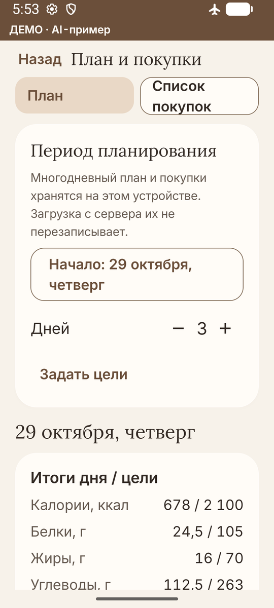 | 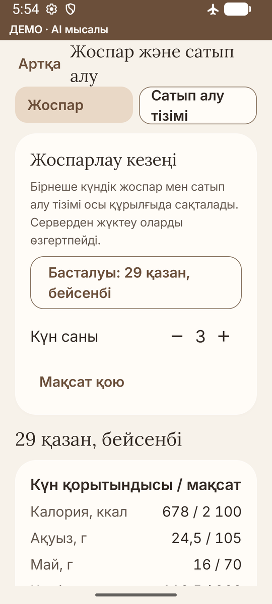 |  |
| Тёмный план | 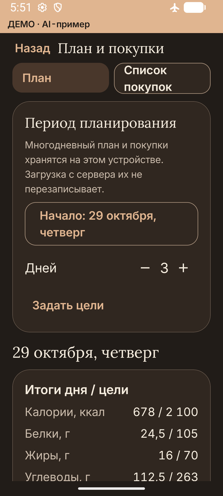 | 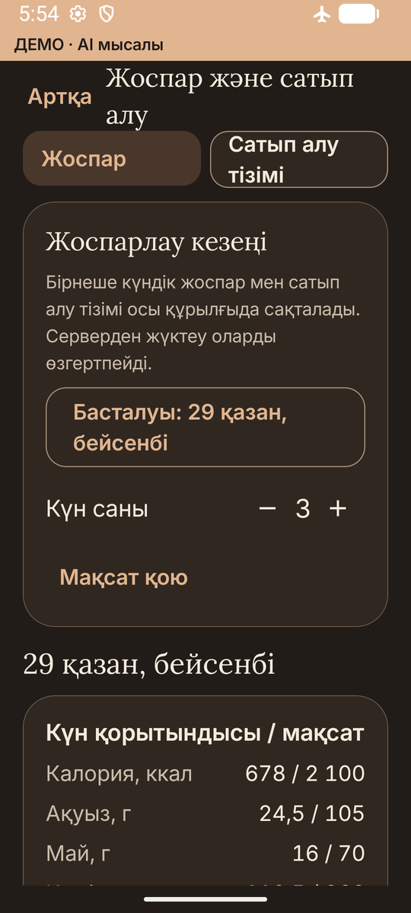 | 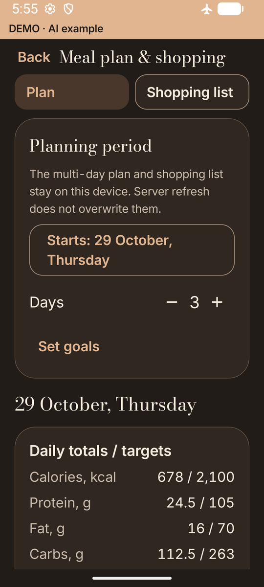 |
| Светлые покупки | 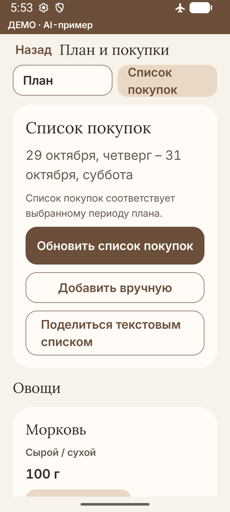 | 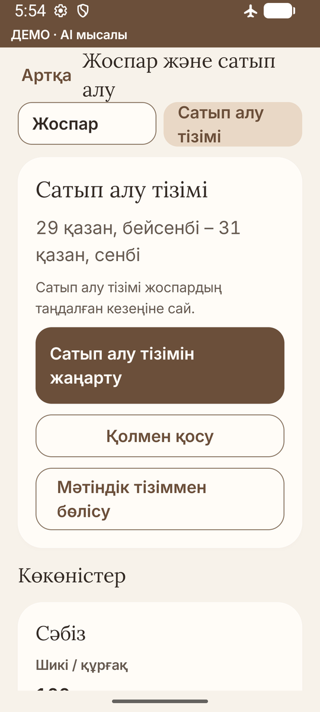 |  |
| Тёмные покупки | 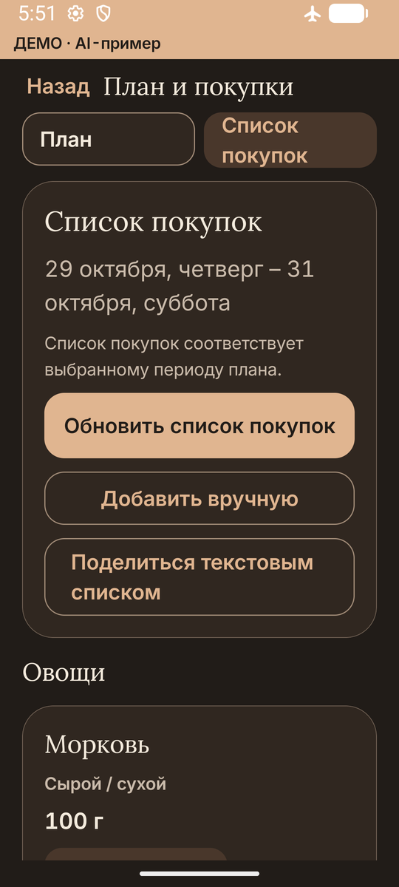 | 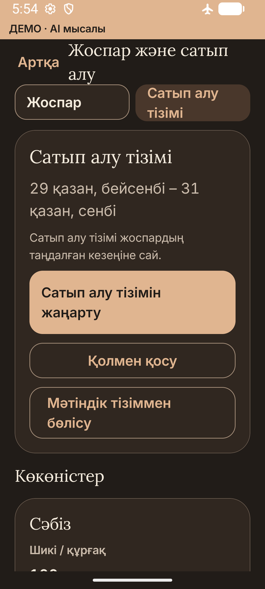 |  |

## Карточки, ошибки и клавиатура

| Запланированное блюдо | Длинное название и клавиатура | Ошибка количества |
|---|---|---|
| 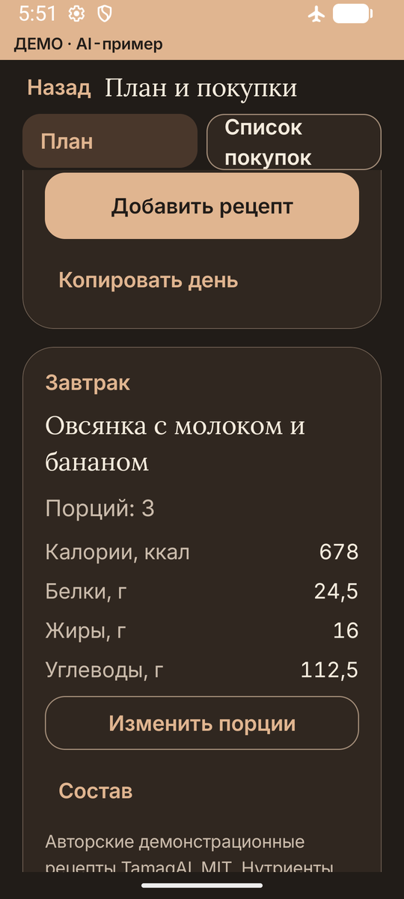 | 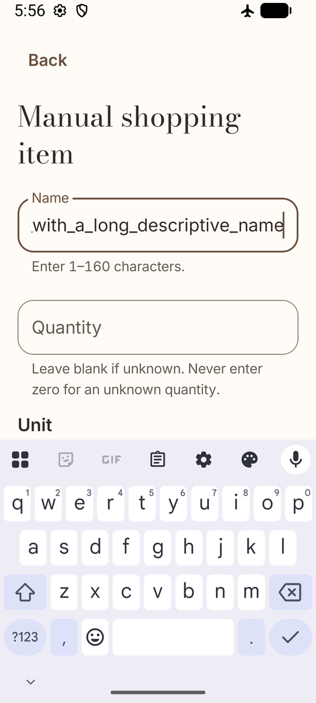 | 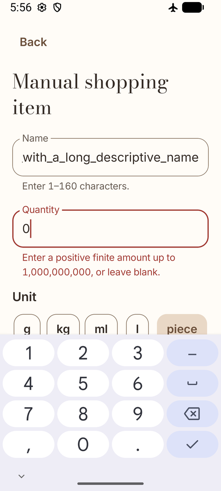 |

Нулевое количество не сохраняется: возле поля появляется понятная ошибка. При открытой клавиатуре форма прокручивается до последней кнопки; кнопка «Save» видна над клавиатурой и остаётся отключённой при ошибке. Последняя ручная позиция списка, её заметка и удаление полностью прокручиваются выше нижнего системного отступа.

| Низ формы над клавиатурой | Последняя позиция списка |
|---|---|
|  | 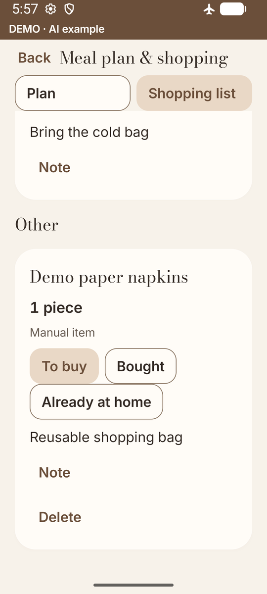 |

## Видеопроверка и пределы проверки

Записан настоящий `screenrecord` длительностью 27,65 с (720 × 1600, без звука) во время успешного `MealPlanningUiTest`: три дня, рецепты, порции, копирование дня, покупки, отметки, заметка, ручная позиция, изменение плана, обновление, системное меню отправки и явное подтверждение съеденной порции. Получатель не выбирался, сообщение не отправлялось. Видео выдаётся отдельно как результат сборки; новый публичный release для этого обновления не создавался.

Служба TalkBack 16.0 была включена на эмуляторе: подтверждены подключение службы, режим touch exploration и видимый фокус доступности. Проверены доступные названия основных кнопок и полей в дереве интерфейса. **Полный проход всех элементов с TalkBack и качество озвучки RU/KK/EN не подтверждены**; их следует проверить вручную. Проверка физического телефона и плавности на Xiaomi в этот этап не выполнялась.

Все изображения здесь просмотрены: реальных email, телефонов, кодов, токенов, ключей и личных фото нет. Для интерфейса использованы существующие шрифты и ресурсы проекта с сохранёнными лицензиями. Платных AI-вызовов при подготовке материалов не было.
